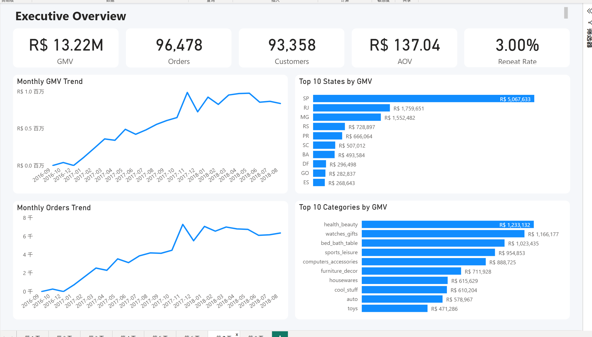
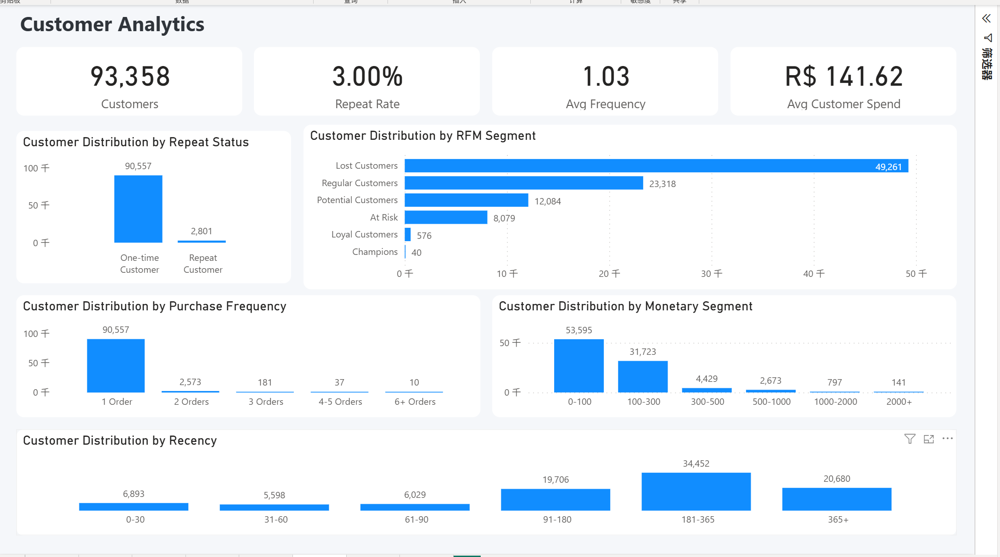
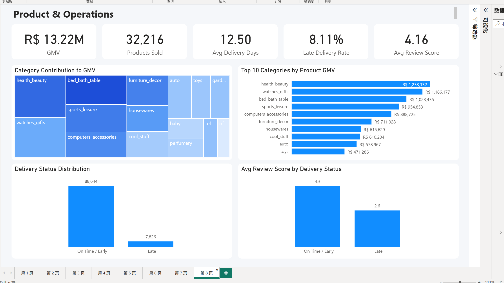

# 电商销售与客户分析项目 | SQL + Power BI

## 项目简介

本项目基于 Olist 巴西电商公开数据集，使用 **MySQL** 完成数据清洗、数据建模和业务指标计算，并使用 **Power BI + DAX** 搭建交互式数据分析仪表板。

项目主要从 **销售表现、客户行为、商品表现和配送运营** 四个方向进行分析，并通过 RFM 客户分层、复购分析和配送时效分析，发现影响业务增长和客户体验的关键问题。

---

## 使用工具

* MySQL
* Power BI
* DAX
* SQL
* RFM 客户分层
* 数据清洗与建模
* 数据可视化
* 业务指标分析

---

## 数据处理流程

本项目按照以下流程完成数据处理：

**Raw Data → Clean Data → Fact Tables → Analysis Mart → Power BI**

主要工作包括：

* 对原始电商数据进行清洗和字段标准化
* 聚合订单商品和评价数据，避免一对多关联导致销售额重复计算
* 构建订单级、商品级和客户级分析数据集
* 使用 SQL 计算 GMV、订单量、客单价、配送时长等核心指标
* 使用窗口函数分析月度销售变化
* 使用 RFM 方法进行客户分层
* 对 SQL 结果和 Power BI 指标进行数据一致性校验

---

## Dashboard Preview

### 1. Executive Overview（经营概览）



主要指标：

* GMV：**R$13.22M**
* Orders（订单量）：**96,478**
* Customers（客户数）：**93,358**
* AOV（平均客单价）：**R$137.04**
* Repeat Rate（复购率）：**3.00%**

主要分析：

* 月度 GMV 趋势
* 月度订单趋势
* 各州销售额排名
* 商品品类销售额排名

---

### 2. Customer Analytics（客户分析）



主要分析：

* 客户数量与复购率
* 平均购买频次
* 平均客户消费金额
* Repeat / One-time Customer（复购 / 一次性客户）分析
* RFM 客户分层
* Recency（最近购买时间）分布
* Monetary（消费金额）分布

通过 RFM 分析发现，**Lost Customers（流失客户）约 49,261 人**，说明客户留存和召回存在较大的优化空间。

---

### 3. Product & Operations（商品与运营分析）



主要指标：

* Product GMV：**R$13.22M**
* Unique Products（不同商品数）：**32,216**
* Avg Delivery Days（平均配送时长）：**12.50 天**
* Late Delivery Rate（延迟配送率）：**8.11%**
* Avg Review Score（平均评价）：**4.16**

主要分析：

* 商品品类 GMV 贡献
* Top 商品品类
* 配送状态分布
* 配送状态与用户评分之间的关系

---

## 关键业务发现

### 1. 客户复购率较低

整体 Repeat Rate（复购率）约为 **3.00%**。

绝大多数客户只完成过一次购买，说明平台在客户留存和二次购买方面仍存在明显提升空间。

---

### 2. 流失客户数量较大

RFM 客户分层结果显示，**Lost Customers（流失客户）约 49,261 人**。

可以针对这部分客户设计优惠券、召回活动、个性化推荐等运营策略，提高客户重新购买的可能性。

---

### 3. 销售存在明显地区集中

São Paulo（圣保罗州，SP）是 GMV 贡献最高的地区，销售额约为：

**R$5.07M**

说明核心销售额集中在少数主要地区，可进一步针对高价值地区进行营销资源配置。

---

### 4. 核心品类贡献明显

`health_beauty`（健康美容）是销售表现最好的商品品类之一，GMV 约为：

**R$1.23M**

高价值品类可以作为重点商品运营和营销投入方向。

---

### 5. 配送延迟明显影响客户评分

配送状态与客户评价之间存在明显差异：

* On Time / Early（准时或提前送达）：平均评分约 **4.3**
* Late（延迟送达）：平均评分约 **2.6**

说明配送体验与客户满意度具有较强关系。

降低延迟配送比例，可能有助于提高整体客户评价和购物体验。

---

## 业务建议

基于以上分析，可以提出以下建议：

1. 针对一次性客户设计二次购买激励，提高复购率。
2. 对 RFM 中的 Lost Customers 开展客户召回活动。
3. 加强 São Paulo 等高价值地区的营销和商品资源投入。
4. 重点运营高 GMV 商品品类，提高核心品类销售贡献。
5. 优化配送流程并重点监控延迟订单，以提升客户满意度。

---

## 项目结构

```text
Ecommerce-Analytics-Project
│
├── dashboard
│   └── Ecommerce_Analytics_Dashboard.pbix
│
├── screenshots
│   ├── 01_Executive_Overview.png
│   ├── 02_Customer_Analytics.png
│   └── 03_Product_Operations.png
│
├── sql
│   ├── 01_data_cleaning.sql
│   ├── 02_business_analysis.sql
│   └── 03_powerbi_dataset.sql
│
└── README.md
```

---

